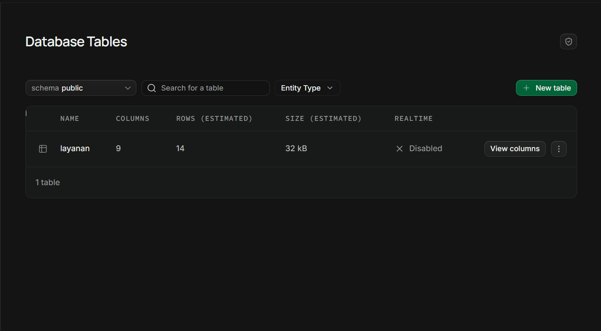
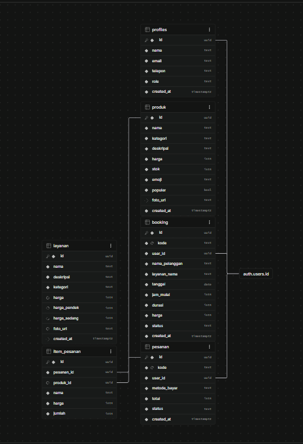
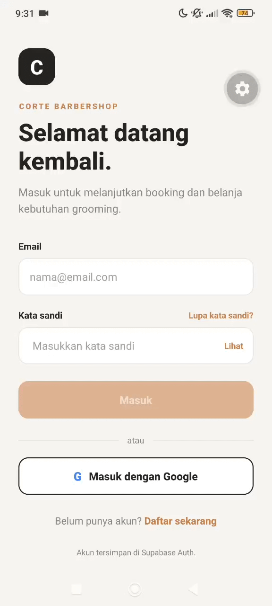
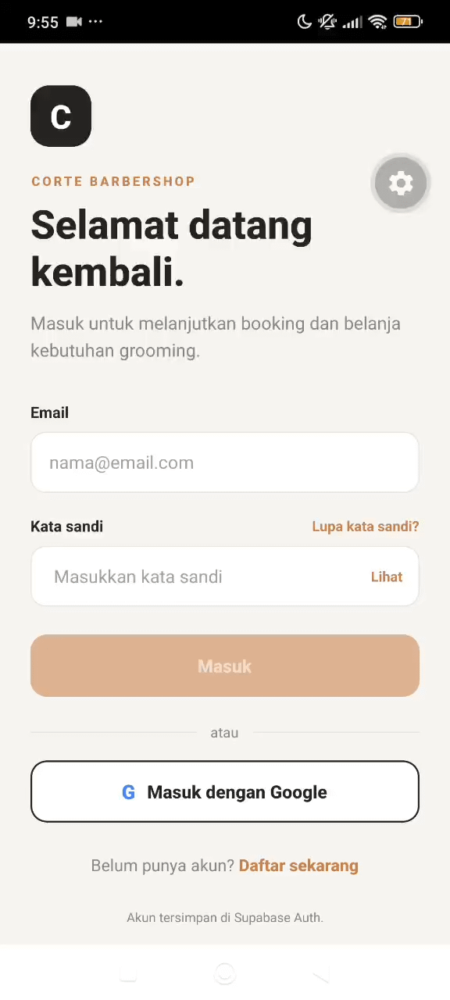
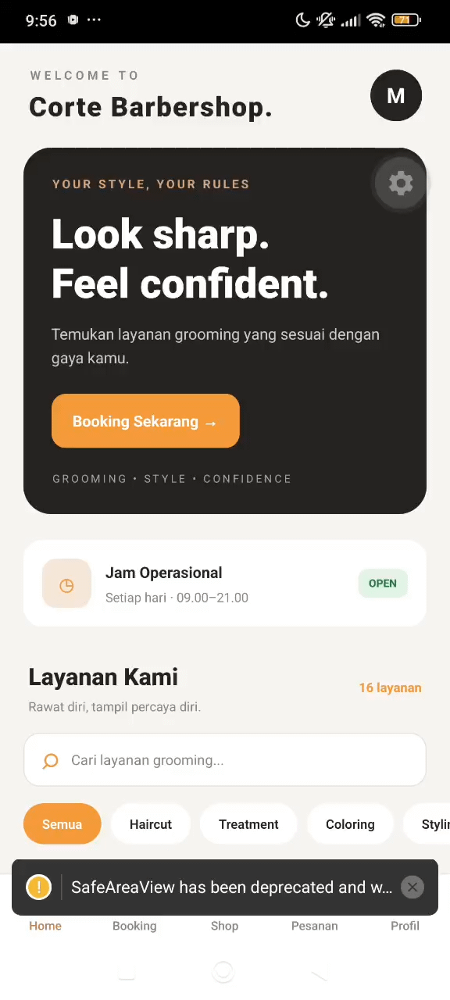
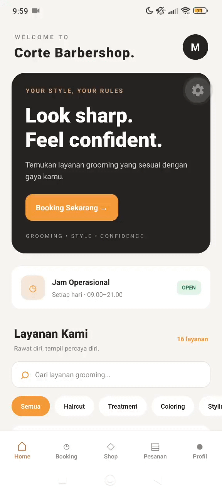

## Integrasi Project Corte Barbershop Ke Supabase ##

### Anggota Kelompok ####
1. Mohammad Rizky Saputra 
2. Ahmad Aly
3. Alvin Ferdiansyah
4. Abdullah Assegaf

### Setup Supabase ###

1. Invite Anggota

2. Tabel Database

3. Skema Tabel Database

### Halaman yang sudah Terkoneksi ###

1. Semua Halaman yang ada di Admin

2. Halaman Registrasi User

3. Halaman Login User

---

### Dashboard User atau Pengguna

1. Layanan Booking ( Untuk Menambahkan Layanan Booking )

--

2. Layanan Shop ( Untuk Menambahkan Layanan Pembelian barang )

--

3. Tampilan Desk. Pesanan & Tampilan Profile ( Untuk Menambahkan Layanan  )

