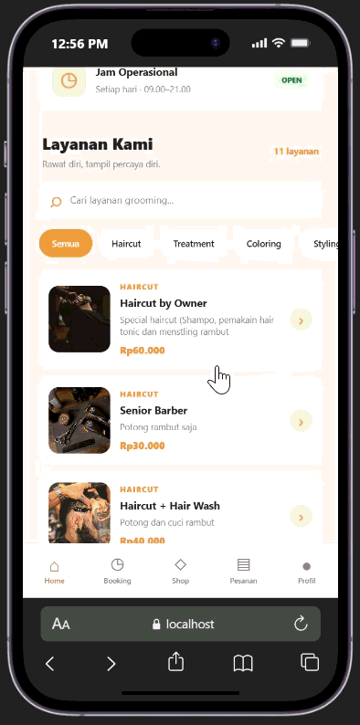
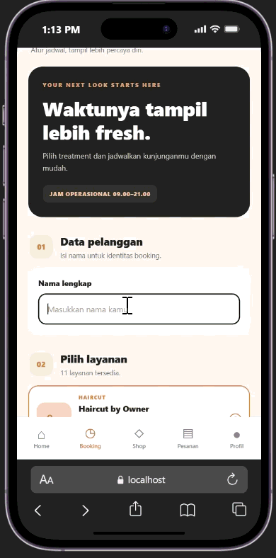
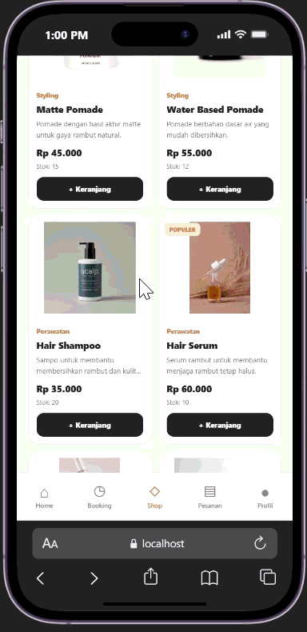
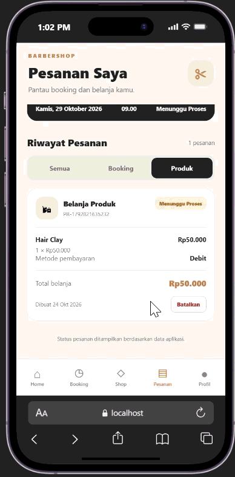
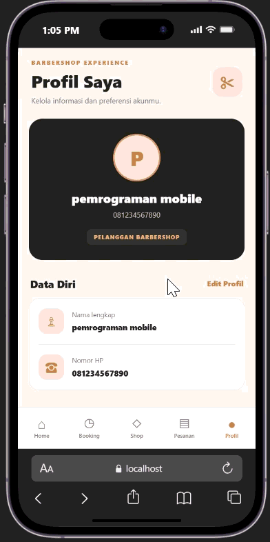

# Corte Barbershop

Corte Barbershop adalah aplikasi mobile yang dirancang untuk memudahkan pelanggan dalam mengakses layanan barbershop secara praktis. Aplikasi ini menyediakan informasi berbagai layanan pangkas rambut dan perawatan, lengkap dengan deskripsi serta harga, sehingga pelanggan dapat memilih layanan yang sesuai dengan kebutuhan mereka.

Selain pemesanan jadwal layanan, aplikasi ini menyediakan toko produk perawatan rambut yang dilengkapi katalog produk, informasi harga dan stok, serta keranjang belanja. Pengguna juga dapat melihat daftar pesanan, memantau status pesanan, dan mengelola informasi profil melalui satu aplikasi.

Aplikasi Corte Barbershop dikembangkan menggunakan React Native dan Expo dengan navigasi yang terdiri dari lima menu utama, yaitu Home, Booking, Shop, Pesanan, dan Profil. Dengan antarmuka yang sederhana dan modern, aplikasi ini diharapkan dapat memberikan pengalaman yang lebih mudah dan nyaman bagi pelanggan dalam memesan layanan serta membeli produk perawatan rambut.

## Fitur utama aplikasi

### 1. Home

Menampilkan pengenalan Corte Barbershop, jam operasional, katalog layanan, dan akses cepat menuju halaman booking.

### 2. Booking layanan

Pelanggan mengisi nama, memilih layanan, menentukan jadwal kunjungan, dan melihat harga sebelum membuat pesanan.

### 3. Shop

Menyediakan produk seperti pomade, sampo, serum, hair tonic, dan produk styling lain, lengkap dengan harga, stok, serta keranjang belanja.

### 4. Pesanan

Menampilkan riwayat booking dan pembelian produk, total pesanan, status pesanan, serta opsi pembatalan untuk pesanan yang masih menunggu proses.

### 5. Profil

Menyediakan tampilan informasi pelanggan, pengeditan nama dan nomor HP, serta pengaturan sederhana dan informasi aplikasi.

## Teknologi yang digunakan
- React Native — membangun antarmuka aplikasi mobile.
- Expo — membantu proses pengembangan dan menjalankan aplikasi.
- Expo Router — mengatur navigasi antarlaman.
- TypeScript — menambahkan tipe data pada kode aplikasi.

============

cara penggunaan
1. git clone "https://github.com/muhammadrizkycrb26-ux/Project_Kelompok2.git"
2. cd .....\barbershop
3. npm install
4. npx expo start

cara ubah pallete:
akses file pada ......\barbershop\src\constants\palette.ts