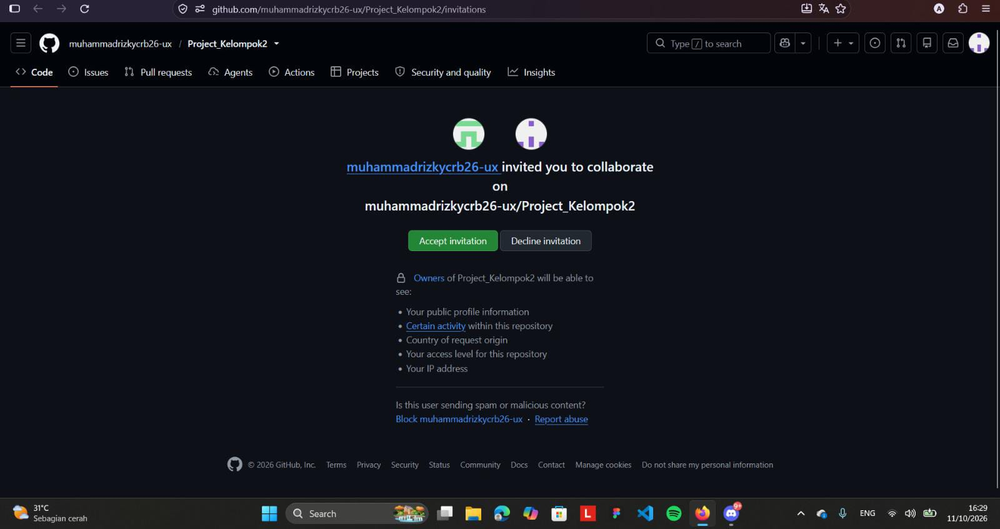
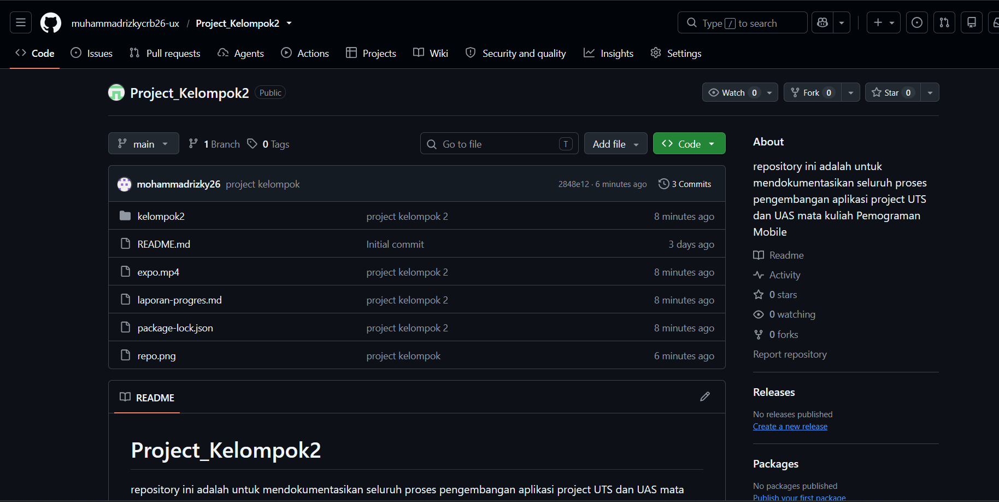
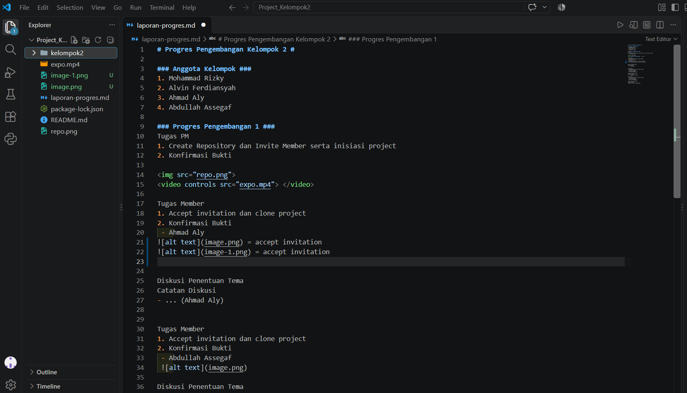

# Progres Pengembangan Kelompok 2 #

### Anggota Kelompok ###
1. Mohammad Rizky 
2. Alvin Ferdiansyah 
3. Ahmad Aly
4. Abdullah Assegaf

### Progres Pengembangan 1 ###
Tugas PM
1. Create Repository dan Invite Member serta inisiasi project
2. Konfirmasi Bukti

<video controls src="expo.mp4"> </video>

Tugas Member
1. Accept invitation dan clone project
2. Konfirmasi Bukti
 - Ahmad Aly
accept invitation:
 
accept invitation:
 
clone project:

Diskusi Penentuan Tema
Catatan Diskusi
- Dari saya, saya mengajukan 1 tema terkait membuat aplikasi Booking arena sport, seperti booking lapangan futsal, badminton, Basket, renang (Ahmad Aly)

Tugas Member
1. Accept invitation dan clone project
2. Konfirmasi Bukti
 - Abdullah Assegaf

Diskusi Penentuan Tema
Catatan Diskusi
- ... (Abdullah Assegaf)

Tugas Member
1. Accept invitation dan clone project
2. Konfirmasi Bukti
 - Alvin Ferdiansyah

Diskusi Penentuan Tema
Catatan Diskusi
- Rental PS (Alvin Ferdiansyah)